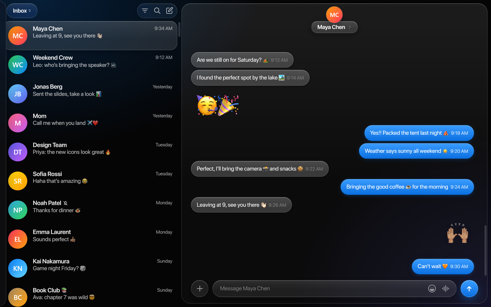
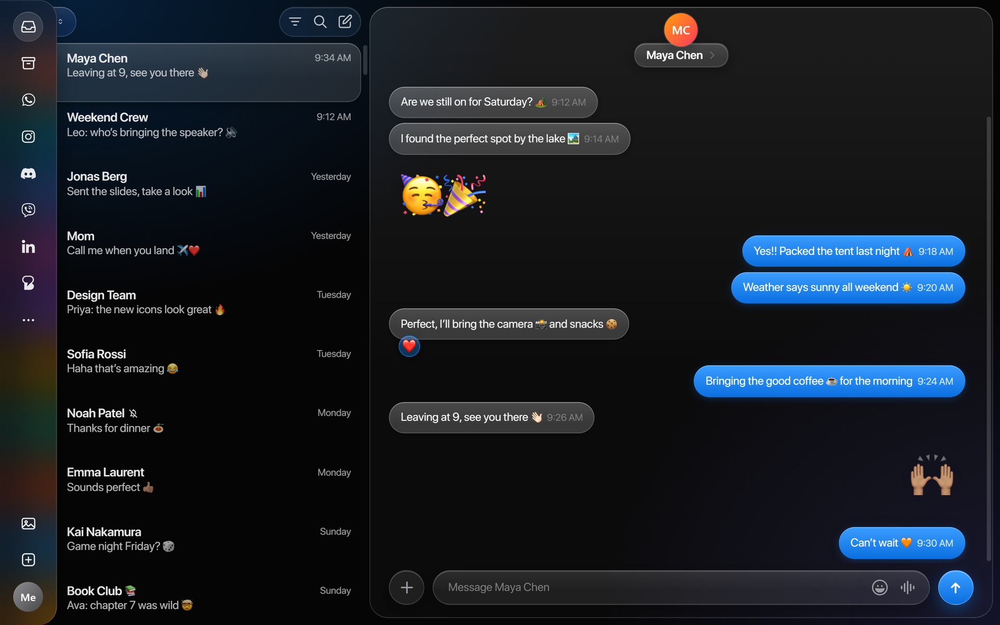
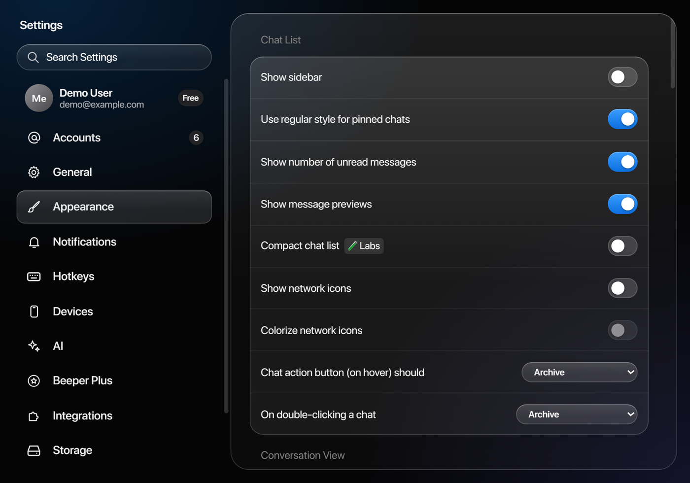
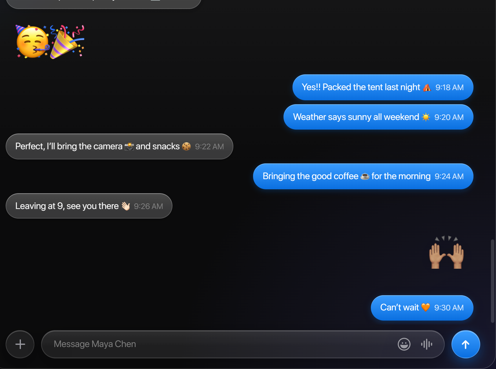

# Beeper Aqua Glass

A dark, translucent theme for [Beeper Desktop](https://www.beeper.com/), inspired by Apple's Liquid Glass design: frosted panels, clean line icons, rounded bubbles and, optionally, Apple emoji on Windows.



> Unofficial community theme. Not affiliated with or endorsed by Beeper or Apple. Screenshots use demo conversations and generated avatars.

## What it changes

**Glass, used the way Apple uses it.** Glass is kept to a few shared surfaces on the navigation layer, never stacked on itself:
- **Sidebar and chat:** a glass card for the chat pane, glass pills for the Inbox switcher, the chat title and date dividers, and frosted received bubbles.
- **Header actions:** filter, search and compose share one glass capsule.
- **Account rail:** a translucent panel that blurs the chat list behind it.

**One icon language.** Beeper's Material icons are replaced with original line drawings in the spirit of SF Symbols: even stroke weight, round caps, and solid fill only where Apple uses it. That covers the sidebar, account rail, message actions, message bar, mini player and settings. Network logos (WhatsApp, Instagram, Discord and others) are drawn as plain white glyphs at one optical size. The emoji button matches the emoji key on the iOS keyboard.

**Finer details:**
- **Accent:** one Apple-blue accent across the app.
- **Sent bubbles and send button:** glossy blue gradient.
- **Settings:** iOS-style toggles, glass dropdowns and grouped glass cards.
- **Reactions:** round pills centred under their bubble.
- **Spacing:** more breathing room in the chat list and around the conversation.
- **Light mode:** the theme also has light-mode values (dark is the primary target).

| Account rail | Settings |
|---|---|
|  |  |

**Optional: Apple emoji on Windows.** Beeper on Windows uses Microsoft's emoji. The optional kit in [`emoji/`](emoji/) makes it use Apple Color Emoji instead, including skin tones, families, couples and flags. Normal text is unaffected. On macOS, Beeper already uses Apple emoji.



## Install

1. Download [`custom.css`](custom.css).
2. Put it in Beeper's data folder, replacing any `custom.css` already there:

   | OS | Path |
   |---|---|
   | Windows | `%APPDATA%\BeeperTexts\custom.css` |
   | macOS | `~/Library/Application Support/BeeperTexts/custom.css` |
   | Linux | `~/.config/BeeperTexts/custom.css` |

3. In Beeper, open **Settings → Appearance** and click **Reload CSS** (or press `Ctrl+Shift+R` / `Cmd+Shift+R`).

Alternatively, paste the contents of `custom.css` into the custom CSS box under **Settings → Appearance** and click **Apply**.

**To remove it,** delete `custom.css` (or clear the box) and reload.

## Optional: Apple emoji on Windows

The kit doesn't include Apple's font. It turns a copy you download yourself into one Beeper can use. Using Apple's emoji outside Apple devices may have licensing implications, and that decision is yours.

1. Install the theme first (above).
2. Download **`AppleColorEmoji-Linux.ttf`** (the *Linux* build, not the Windows one) from the [samuelngs/apple-emoji-ttf releases](https://github.com/samuelngs/apple-emoji-ttf/releases) into your Downloads folder.
3. Install [Python 3](https://www.python.org/downloads/), then run from the `emoji` folder:

   ```powershell
   powershell -ExecutionPolicy Bypass -File .\install-apple-emoji.ps1
   ```

4. **Settings → Appearance → Reload CSS** in Beeper.

The script installs `fonttools` and `uharfbuzz`, builds the font (about a minute) and verifies it. It then saves the font as `%APPDATA%\BeeperTexts\AppleColorEmoji.ttf` and adds a small block to your `custom.css`. It changes nothing outside the BeeperTexts folder and doesn't touch Windows' own emoji font. To undo it, run the script with `-Uninstall`.

**Why a build step?** That release joins multi-part emoji (skin tones, families, flags) with Apple's own shaping table, which Chromium, and so Beeper, ignores. Without the rebuild, 👍🏽 shows up as 👍 next to a skin-colour square.
- **What the script does:** [`build_emoji_font.py`](emoji/build_emoji_font.py) reads the emoji list from your Beeper install and runs each sequence through Apple's table with HarfBuzz. It rewrites the results as a standard OpenType table that Chromium uses.
- **Verification:** it re-checks every sequence (about 4,800) against the original, glyph by glyph.

**Linux:** run `python build_emoji_font.py AppleColorEmoji-Linux.ttf ~/.config/BeeperTexts/AppleColorEmoji.ttf --asar /path/to/beeper/resources/app.asar`. Then append [`emoji/emoji-block.css`](emoji/emoji-block.css) to your `custom.css`, replacing `__FONT_URL__` with `file:///home/<you>/.config/BeeperTexts/AppleColorEmoji.ttf`.

## Compatibility

- **Tested:** built and checked on Beeper Desktop 4.3 on Windows 11, dark mode.
- **Untested:** macOS, Linux and light mode. The theme should work there, but expect rough edges.
- **Beeper updates:** Beeper changes its class names now and then. If something looks off after an update, please open an issue with a screenshot.
- **Native window frame:** on Windows, Beeper uses the normal Windows title bar, which CSS can't style.

## Customising

All colours, radii, glass strengths and spacing are CSS variables in the `:root` block at the top of `custom.css`, so one change applies everywhere.

The icon drawings live in [`tools/gen-icons.mjs`](tools/gen-icons.mjs). To change or add one, edit its table and run `node tools/gen-icons.mjs` from the repo root, which regenerates the icon block at the end of `custom.css`.

## Credits

- **Beeper:** [Beeper](https://www.beeper.com/), the app this theme is for, and the [community themes](https://github.com/beeper/themes) that document its custom CSS support.
- **Design inspiration:** Apple's Liquid Glass and SF Symbols. No Apple assets are included: every icon here is an original drawing.
- **Apple emoji build:** [samuelngs/apple-emoji-ttf](https://github.com/samuelngs/apple-emoji-ttf) provides the converted Apple Color Emoji build the optional kit starts from.
- **Font tooling:** [HarfBuzz](https://github.com/harfbuzz/harfbuzz) / [uharfbuzz](https://github.com/harfbuzz/uharfbuzz) and [fontTools](https://github.com/fonttools/fonttools) power the emoji rebuild.

Beeper is a trademark of its owner. Apple, Apple Color Emoji, SF Pro and SF Symbols are trademarks of Apple Inc. This project is independent and is not endorsed by either.

## License

[MIT](LICENSE) for the theme, scripts and icon drawings in this repository. The license doesn't cover Apple's emoji font, which isn't distributed here.
